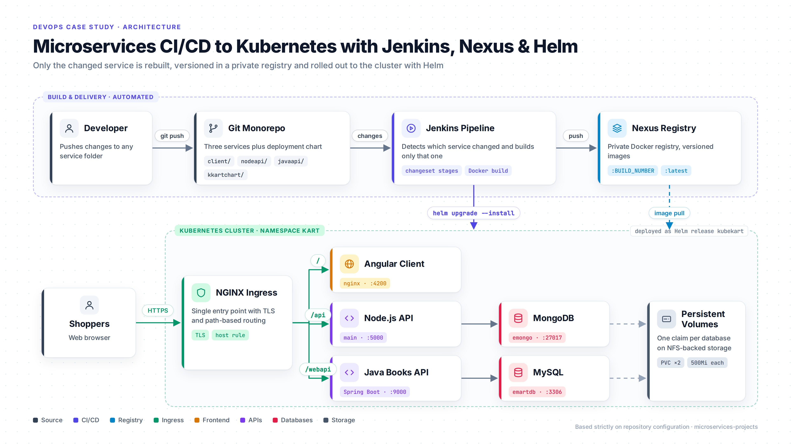
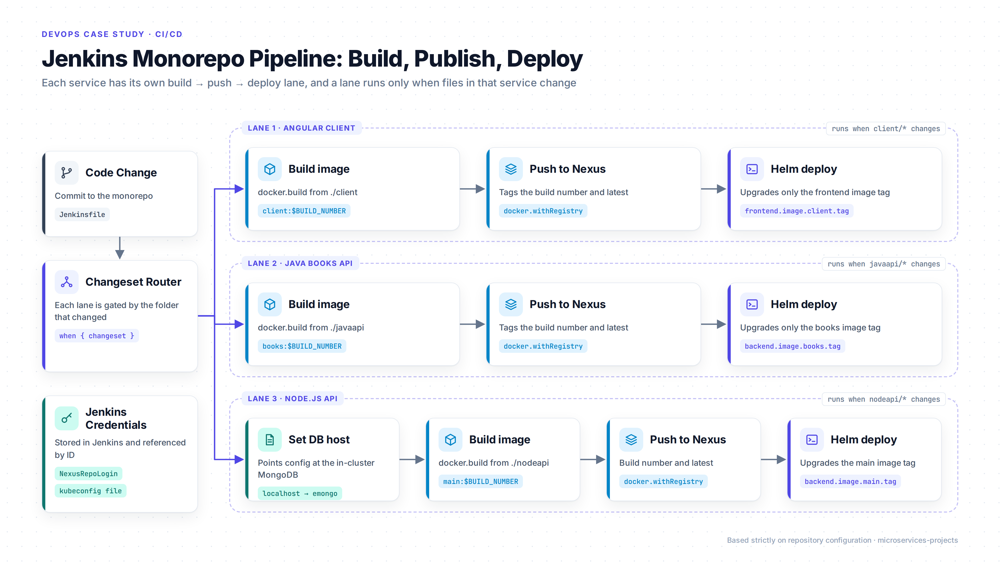
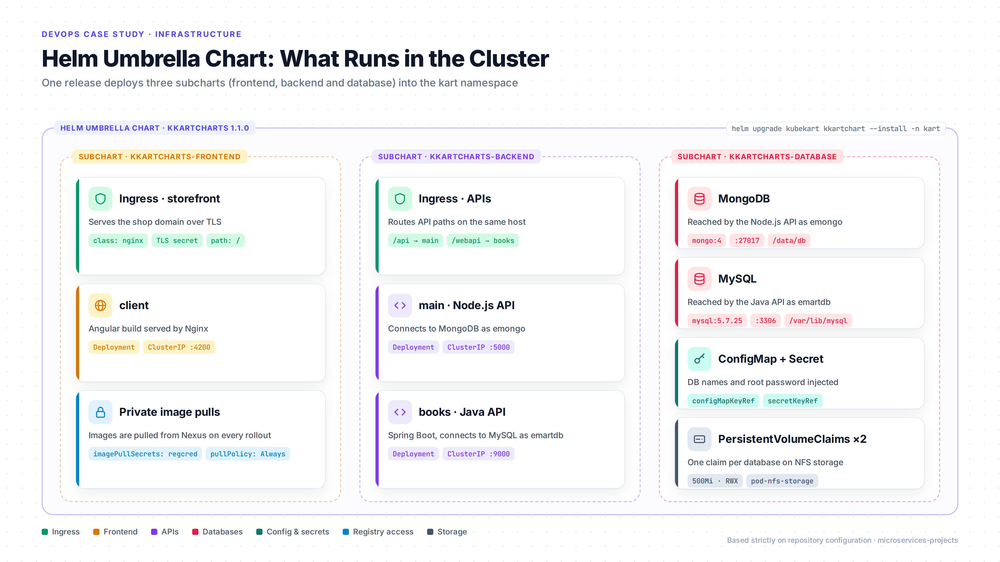
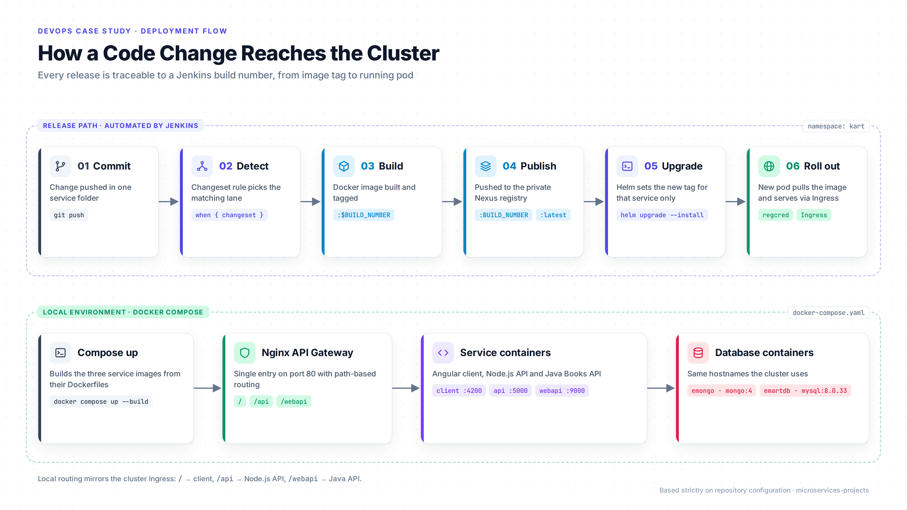
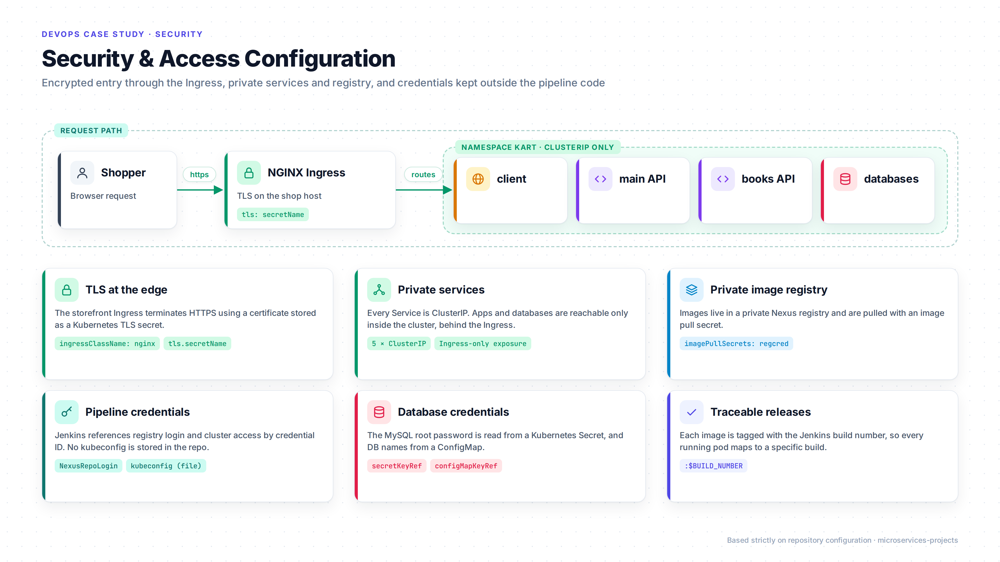

# DevOps Deployment & Infrastructure

**Microservices CI/CD to Kubernetes with Jenkins, Nexus & Helm**

Source repository: [github.com/walidali123/microservices-projects](https://github.com/walidali123/microservices-projects)

## Overview

This project delivers a three-service e-commerce application (an Angular frontend, a Node.js API and a Java Spring Boot API, backed by MongoDB and MySQL) to Kubernetes through an automated Jenkins pipeline. The application code is an existing sample app; the work shown here is its containerization, the CI/CD pipeline, the private image registry integration and the Kubernetes deployment with Helm. A Docker Compose setup with an Nginx API gateway provides a matching local environment.

## Architecture

All services live in one Git monorepo. When code changes, Jenkins rebuilds only the affected service, pushes the image to a private Nexus Docker registry, and upgrades the Helm release on the Kubernetes cluster. Inside the cluster, an NGINX Ingress receives HTTPS traffic and routes it by path: `/` to the Angular client, `/api` to the Node.js API, and `/webapi` to the Java API. The two APIs use MongoDB and MySQL respectively, each with its own persistent volume.

## CI/CD

The root `Jenkinsfile` defines one build, push and deploy lane per service. Each lane is gated with a `changeset` condition, so a change under `client/`, `javaapi/` or `nodeapi/` triggers only that service's lane. A lane builds the image with the Docker Pipeline plugin, tags it with the Jenkins build number, and pushes it to Nexus under both the build number and `latest`. It then runs `helm upgrade --install`, overriding the image tag for that one service. The Node.js lane first points its database configuration at the in-cluster MongoDB service. Registry login and cluster access are supplied from the Jenkins credentials store.

## Infrastructure

The deployment is packaged as a Helm umbrella chart with three subcharts. The **frontend** subchart holds the client Deployment, its Service, and the TLS-enabled Ingress for the storefront. The **backend** subchart holds the two API Deployments and Services, and an Ingress for the API paths. The **database** subchart runs MongoDB and MySQL, with their configuration and credentials supplied through a ConfigMap and a Secret. Each database stores its data on a PersistentVolumeClaim backed by an NFS storage class. Database Services use fixed names (`emongo` and `emartdb`) so the applications reach them by the same hostnames everywhere.

Every image is built with a multi-stage Dockerfile. The Angular app is compiled with Node.js and served by Nginx. The Java API is built with Maven and runs as a JAR on a clean OpenJDK 8 image, without the build tools. The Node.js API installs its dependencies in a separate build stage.

## Deployment Flow

A release moves from commit, to changeset detection, to image build, to publishing in Nexus, to a Helm upgrade and a rollout. Every running image carries the Jenkins build number, so each deployment traces back to a specific build. For development, `docker compose up --build` starts all six containers locally, behind an Nginx API gateway that uses the same `/`, `/api` and `/webapi` routing as the cluster Ingress.

## Security

External traffic enters only through the NGINX Ingress, which serves the storefront over TLS using a Kubernetes TLS secret. All five Services are ClusterIP, so the applications and databases are not directly reachable from outside the cluster. Images come from a private registry using an image pull secret. Jenkins accesses the registry and the cluster through stored credentials rather than values in the repository. The MySQL root password is injected from a Kubernetes Secret, and non-sensitive database settings come from a ConfigMap.

## Technologies

Jenkins (declarative pipeline, Docker Pipeline plugin), Docker (multi-stage builds), Docker Compose, Sonatype Nexus (private Docker registry), Kubernetes (Deployments, Services, Ingress, ConfigMaps, Secrets, PersistentVolumeClaims, namespaces), Helm (umbrella chart with subcharts), NGINX Ingress Controller, Nginx (API gateway and static file serving), MongoDB, MySQL, NFS-backed storage, Maven.

## DevOps Responsibilities

- Wrote multi-stage Dockerfiles for an Angular frontend, a Node.js API and a Spring Boot API.
- Built a Jenkins monorepo pipeline that detects which service changed and runs only that service's build, push and deploy stages.
- Integrated a private Nexus Docker registry, with build-number versioning and pull-secret access from the cluster.
- Packaged the full stack as a Helm umbrella chart with frontend, backend and database subcharts.
- Configured an NGINX Ingress with TLS and path-based routing to three services.
- Deployed MongoDB and MySQL with persistent storage, ConfigMap-based configuration and Secret-based credentials.
- Automated rollouts with `helm upgrade --install` and per-service image tag overrides.
- Set up a Docker Compose environment with an Nginx API gateway that mirrors the cluster's routing.

## Project Results

- Changing one service rebuilds and redeploys only that service, while the others stay untouched.
- Every deployed image is traceable to a specific Jenkins build number.
- The entire application, including databases, storage and routing, is defined as a versioned Helm chart and deploys with a single command.
- Only the Ingress is exposed externally, with all application and database services internal to the cluster.
- Developers can run the full stack locally with one Docker Compose command, using the same URL routing as the cluster.
